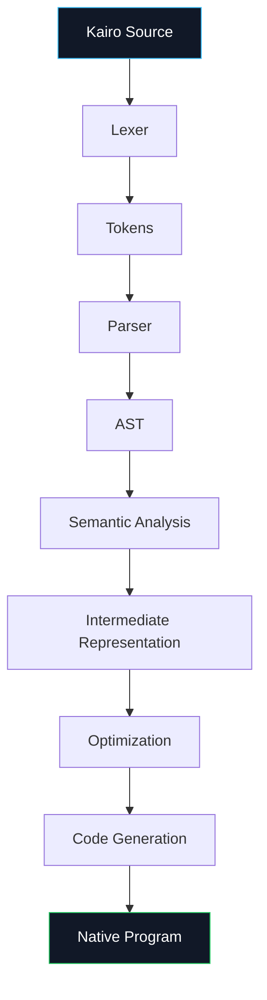
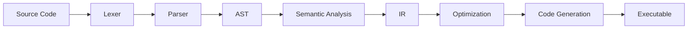

<div align="center">

# âš¡ KAIRO

### A programming language built from curiosity, engineered with intent.

<p>
  <strong>Fast.</strong>
  &nbsp;·&nbsp;
  <strong>Safe.</strong>
  &nbsp;·&nbsp;
  <strong>Expressive.</strong>
  &nbsp;·&nbsp;
  <strong>Still being forged.</strong>
</p>

<br />

<a href="https://github.com/Manzi-Elvis/Kairo">
  
</a>
<a href="https://github.com/Manzi-Elvis/Kairo/network/members">
  
</a>
<a href="https://github.com/Manzi-Elvis/Kairo/issues">
  
</a>
<a href="https://github.com/Manzi-Elvis/Kairo">
  
</a>
<a href="LICENSE">
  
</a>

<br />
<br />

> **Kairo is an experimental programming language I'm building from the ground up — one lexer, one parser, one compiler pass, and one crazy idea at a time.**

<br />

<a href="#-what-is-kairo">What is Kairo?</a>
&nbsp; • &nbsp;
<a href="#-why-kairo">Why Kairo?</a>
&nbsp; • &nbsp;
<a href="#-quick-start">Quick Start</a>
&nbsp; • &nbsp;
<a href="#-language">Language</a>
&nbsp; • &nbsp;
<a href="#-architecture">Architecture</a>
&nbsp; • &nbsp;
<a href="#-roadmap">Roadmap</a>
&nbsp; • &nbsp;
<a href="#-contributing">Contributing</a>

</div>

---

> [!IMPORTANT]
> **Kairo is experimental and under active development.**
>
> The language, syntax, compiler architecture, and semantics are expected to evolve. Some features described in the roadmap are intentionally aspirational and are not implemented yet.
>
> That's not a bug.
>
> **That's the point.**
>
> You're looking at a programming language while it's still being forged.

---

## Table of Contents

- [ What is Kairo?](#-what-is-kairo)
- [ Why Kairo?](#-why-kairo)
- [ Design Philosophy](#-design-philosophy)
- [ Goals](#-goals)
- [ Current Status](#-current-status)
- [ Quick Start](#-quick-start)
- [ Your First Kairo Program](#-your-first-kairo-program)
- [ The Language](#-the-language)
- [ Language Building Blocks](#-language-building-blocks)
- [ How Kairo Works](#️-how-kairo-works)
- [ Compiler Architecture](#️-compiler-architecture)
- [ Project Structure](#-project-structure)
- [ Roadmap](#️-roadmap)
- [ Development Status](#-development-status)
- [ Testing](#-testing)
- [ Performance](#-performance)
- [ Tooling](#️-tooling)
- [ Documentation](#-documentation)
- [ Contributing](#-contributing)
- [ Ideas & Language Design](#-ideas--language-design)
- [ Reporting Bugs](#-reporting-bugs)
- [ Community](#-community)
- [ Why Contribute?](#️-why-contribute)
- [ About the Creator](#-about-the-creator)
- [ License](#-license)

---

# âš¡ What is Kairo?

**Kairo** is an experimental programming language being designed and implemented from scratch.

It started with a simple question:

> **What if I built the language I wish existed?**

So instead of just learning how compilers work by reading about them, I decided to build one.

Kairo explores the entire journey of a programming language:

```text
Source Code
     │
     â–¼
   Lexer
     │
     â–¼
   Parser
     │
     â–¼
    AST
     │
     â–¼
 Semantic Analysis
     │
     â–¼
 Intermediate Representation
     │
     â–¼
 Optimization
     │
     â–¼
 Code Generation
     │
     â–¼
 Executable
```

Every box represents a new problem to solve.

Every solved problem becomes another piece of Kairo.

And every mistake teaches me something about language design.

---

# 💭 Why Kairo?

There are already incredible programming languages.

C is powerful.

C++ is powerful.

Rust is powerful.

Go is beautifully pragmatic.

Python is incredibly productive.

JavaScript somehow runs half the internet.

So...

**Why build another one?**

Because building a programming language is one of the best ways to understand programming itself.

Kairo is my exploration of:

- language design
- compiler construction
- type systems
- parsing
- code generation
- runtime design
- memory management
- performance
- developer experience
- concurrency
- systems programming

I'm not trying to declare war on Rust.

I'm not trying to "kill C++."

I'm building something, learning something, and seeing how far I can take it.

---

# Design Philosophy

Kairo is being shaped around a few principles.

### Performance

Programs should not need to sacrifice performance simply because the language is expressive.

### Safety

The language should make it easier to write correct software and harder to accidentally write dangerous software.

### Clarity

Code should communicate intent.

I don't want developers fighting the language just to express a simple idea.

### Scalability

Kairo should eventually be useful beyond toy programs.

The long-term goal is a language capable of growing from:

```text
tiny scripts
     ↓
CLI tools
     ↓
applications
     ↓
services
     ↓
systems software
```

### Simplicity

Complexity is sometimes necessary.

Unnecessary complexity isn't.

### 🔬 Experimentation

Kairo is also a laboratory.

Some ideas will work.

Some will fail spectacularly.

Some will get deleted.

That's part of the process.

---

# Goals

The long-term vision for Kairo includes:

| Goal | Direction |
|---|---|
| Performance | Native, efficient execution |
| Safety | Safer language primitives and semantics |
| Expressiveness | Concise, readable programs |
| Concurrency | Modern concurrency primitives |
| Modularity | Clean modules and reusable packages |
| Tooling | Formatter, diagnostics, language server |
| Ecosystem | Standard library and package ecosystem |
| Portability | Multiple supported platforms |
| DX | Great developer experience |
| Research | A playground for language-design ideas |

These are **goals**, not promises.

Kairo earns them one feature at a time.

---

# Current Status

<div align="center">

### 🚧 Kairo is being forged.

**Current stage:** Experimental compiler / language development

</div>

The project is intentionally being developed incrementally.

The current priority is getting the **language core and compiler pipeline** right before attempting to build a giant ecosystem around it.

That means:

```text
        Syntax
          ↓
        Lexer
          ↓
        Parser
          ↓
         AST
          ↓
    Semantic Analysis
          ↓
       Codegen
          ↓
     Native Program
```

The boring-looking compiler infrastructure is actually where the fun begins.

---

# Quick Start

> [!NOTE]
> Installation instructions will evolve as Kairo's toolchain matures.

Clone the repository:

```bash
git clone https://github.com/Manzi-Elvis/Kairo.git
cd Kairo
```

Build the project using the repository's current build system.

For the Rust-based development environment:

```bash
cargo build
```

Run the available tests:

```bash
cargo test
```

Run the compiler/application:

```bash
cargo run
```

> **If you're here to experiment with the compiler itself, welcome.**
>
> You're officially inside the machine.

---

# Your First Kairo Program

The goal is for Kairo code to remain readable even when the compiler underneath becomes extremely sophisticated.

A minimal program looks like:

```kairo
fn main() {
    print("Hello, Kairo!");
}
```

Simple.

Readable.

No ceremony.

No 14-line configuration file required just to say hello.

---

# 📖 The Language

Kairo's syntax is intentionally being developed around familiar programming concepts while leaving room for its own identity.

## Variables

```kairo
fn main() {
    let x = 10;
    let y = 20;

    print(x + y);
}
```

---

## Arithmetic

```kairo
fn main() {
    let a = 10;
    let b = 3;

    print(a + b);
    print(a - b);
    print(a * b);
    print(a / b);
}
```

---

## Comparisons

```kairo
fn main() {
    let x = 10;

    print(x > 5);
    print(x == 10);
}
```

---

## Conditions

```kairo
fn main() {
    let age = 20;

    if age >= 18 {
        print("Adult");
    } else {
        print("Minor");
    }
}
```

---

## Functions

```kairo
fn add(a, b) {
    return a + b;
}

fn main() {
    let result = add(10, 20);

    print(result);
}
```

> [!WARNING]
> The examples above represent the **intended/current language direction**. If a construct has not yet been implemented in the current compiler, consider it part of the language design rather than a claim that it already works.

---

# Language Building Blocks

Kairo is being developed from the fundamentals upward.

### Current / foundational areas

- Lexical analysis
- Tokenization
- Parsing
- Abstract syntax trees
- Expressions
- Statements
- Variables
- Literals
- Operators
- Functions
- Control flow
- Compiler diagnostics
- Code generation

### Planned areas

- Static type system
- Modules
- Richer data structures
- Error handling
- Memory model
- Standard library
- Concurrency
- Generics
- Package management
- Language server
- Formatter
- Debugging tools

The exact semantics will evolve as the language matures.

---

# How Kairo Works

At a high level:



The idea is simple:

**source code goes in → executable software comes out.**

The interesting part is everything between those two points.

---

# Compiler Architecture

The compiler is being designed as a pipeline.



## 1. Lexer

The lexer turns raw source text into tokens.

```text
let x = 10;
```

becomes conceptually:

```text
LET
IDENTIFIER(x)
EQUALS
INTEGER(10)
SEMICOLON
```

---

## 2. Parser

The parser turns tokens into structure.

```text
LET x = 10
```

becomes part of an:

```text
Abstract Syntax Tree
```

---

## 3. AST

The AST represents the structure and meaning of the source program.

Conceptually:

```text
VariableDeclaration
├── name: x
└── value
    └── IntegerLiteral
        └── 10
```

---

## 4. Semantic Analysis

This is where Kairo starts asking:

> "Okay... but does this actually make sense?"

Examples:

- Is the variable defined?
- Are types compatible?
- Is a function call valid?
- Is a return statement valid?
- Are language rules being respected?

---

## 5. Intermediate Representation

Eventually, high-level syntax needs to become something closer to what the machine can execute.

That's where intermediate representations come in.

```text
Kairo
  ↓
AST
  ↓
IR
  ↓
Optimized IR
  ↓
Machine Code
```

---

## 6. Code Generation

The final stage translates the compiler's internal representation into executable code.

This is where:

> "I wrote some code"

becomes:

> "The CPU can execute this."

Which is pretty cool.

---

# Project Structure

The repository will continue evolving as the compiler grows.

A conceptual view:

```text
Kairo/
│
├── src/                 # Compiler implementation
│
├── examples/            # Kairo programs
│
├── tests/               # Compiler and language tests
│
├── docs/                # Language & compiler documentation
│
├── README.md
├── LICENSE
└── Cargo.toml
```

The structure will change when the project needs it to.

I'd rather evolve the architecture than preserve a pretty folder tree forever.

---

# Roadmap

Kairo is being built in stages.

## Phase 01 — Foundation

- [x] Project bootstrap
- [x] Compiler skeleton
- [x] Lexer foundations
- [x] Parser foundations
- [x] AST foundations
- [x] Basic expressions
- [ ] Expand diagnostics
- [ ] Expand test coverage

## Phase 02 — Language Core

- [ ] Variables
- [ ] Functions
- [ ] Control flow
- [ ] Type system
- [ ] Data structures
- [ ] Modules
- [ ] Error handling

## Phase 03 — Compiler

- [ ] Intermediate representation
- [ ] Semantic analysis
- [ ] Native code generation
- [ ] Optimization passes
- [ ] Better compiler diagnostics
- [ ] Cross-platform compilation

## Phase 04 — Runtime & Standard Library

- [ ] Runtime
- [ ] Strings
- [ ] Collections
- [ ] File I/O
- [ ] Networking
- [ ] Standard library

## Phase 05 — Concurrency

- [ ] Tasks
- [ ] Channels
- [ ] Synchronization primitives
- [ ] Async execution model
- [ ] Structured concurrency

## Phase 06 — Developer Experience

- [ ] Kairo CLI
- [ ] REPL
- [ ] Formatter
- [ ] Language server
- [ ] VS Code extension
- [ ] Debugging support
- [ ] Better error messages

## Phase 07 — Ecosystem

- [ ] Package manager
- [ ] Package registry
- [ ] Official documentation site
- [ ] Online playground
- [ ] Community packages
- [ ] Contributor ecosystem

## Phase 08 — The Big One

```text
        Kairo
          │
     ┌────┴────┐
     â–¼         â–¼
 Compiler    Ecosystem
     │         │
     â–¼         â–¼
 Runtime    Packages
     │         │
     └────┬────┘
          â–¼
     Production
      Software
```

Eventually:

> **Build real software with Kairo.**

---

# 📊 Development Status

| Component | Status |
|---|---|
| Project foundation | 🟢 Active |
| Lexer | 🟢 Active |
| Parser | 🟢 Active |
| AST | 🟢 Active |
| Language design | 🟡 Evolving |
| Semantic analysis | 🟡 Developing |
| Type system | 🟡 Planned / evolving |
| Native code generation | 🟡 Developing |
| Standard library | 🔴 Planned |
| Package manager | 🔴 Planned |
| LSP | 🔴 Planned |
| VS Code extension | 🔴 Planned |
| Playground | 🔴 Planned |
| Production readiness | 🔴 Not yet |

**Kairo is not production-ready.**

And I'd rather say that clearly than pretend otherwise.

---

# Testing

A programming language without tests eventually becomes a programming language where changing one line mysteriously breaks seventeen other things.

So testing is part of the compiler itself.

The goal is to test:

```text
Source
  ↓
Lexing
  ↓
Parsing
  ↓
AST
  ↓
Semantic Analysis
  ↓
Code Generation
  ↓
Execution
```

Run the test suite with:

```bash
cargo test
```

As the language grows, the test suite will become executable documentation for Kairo's semantics.

---

# âš¡ Performance

Performance matters.

But:

> **"It's fast."**

is not a benchmark.

So Kairo will eventually maintain reproducible benchmarks rather than relying on marketing numbers.

The goal is to measure things such as:

- compilation time
- runtime performance
- memory usage
- binary size
- optimization effectiveness
- startup time

When meaningful benchmark data exists, it will live here.

Until then:

**No fake numbers.**

---

# Tooling

A programming language isn't just a compiler.

A good language eventually needs an ecosystem around it.

The Kairo tooling vision includes:

```text
kairo
│
├── build
├── run
├── test
├── fmt
├── check
├── repl
├── doc
└── package
```

Eventually:

```text
Editor
  │
  â–¼
Language Server
  │
  ├── autocomplete
  ├── diagnostics
  ├── go-to-definition
  ├── rename
  ├── hover
  └── formatting
```

The compiler is the beginning.

**The developer experience is the destination.**

---

# Documentation

Documentation will eventually be split into several layers.

### Beginner

**Kairo Tour**

Learn the language by building small programs.

### Intermediate

**Kairo Language Reference**

Detailed syntax and semantics.

### Advanced

**Compiler Internals**

Learn how Kairo turns source code into executable programs.

### Deep Dive

**Language Design**

Why Kairo works the way it does.

---

# 💡 Ideas & Language Design

This is one of the most important parts of Kairo.

Programming-language design isn't just:

```text
"How do I implement this?"
```

It's also:

```text
"Should this feature exist at all?"
```

Questions that Kairo will eventually have to answer include:

- How should ownership work?
- Should memory management be automatic?
- How should errors be represented?
- How should generics work?
- What should concurrency look like?
- How should async code behave?
- What should modules look like?
- How much type inference is appropriate?
- How much metaprogramming is useful?
- Where should Kairo draw the line between simplicity and power?

I want these decisions to happen **in public** whenever possible.

If you have a strong opinion:

**I want to hear it.**

---

# Contributing

You do **not** need to be a compiler expert to contribute.

Seriously.

You can contribute by:

-  Reporting bugs
-  Improving documentation
-  Adding tests
-  Proposing language features
-  Improving compiler internals
-  Improving performance
-  Refactoring code
-  Creating examples
-  Building tooling
-  Reviewing pull requests
-  Joining language-design discussions

## Getting started

```bash
git clone https://github.com/Manzi-Elvis/Kairo.git

cd Kairo

cargo build

cargo test
```

Then:

```text
1. Find an issue
2. Fork the repository
3. Create a branch
4. Make your change
5. Test it
6. Open a pull request
```

Before contributing, please read:

- [`CONTRIBUTING.md`](CONTRIBUTING.md)
- [`CODE_OF_CONDUCT.md`](CODE_OF_CONDUCT.md)
- [`SECURITY.md`](SECURITY.md)

---

# 🌍 Community

Kairo is being built in public.

That means the community isn't something I want to add **after** the language is finished.

The community should help shape what Kairo becomes.

### 💬 Discussions

Have an idea?

Start a discussion.

### 🐛 Issues

Found something broken?

Open an issue.

### 🔧 Pull Requests

Want to fix something?

Send a PR.

### Language Design

Think Kairo should work differently?

Let's talk about it.

---

# ❤️ Why Contribute?

Because you can literally say:

> **"I helped build a programming language."**

That's pretty cool.

But more importantly, Kairo is an opportunity to learn things that most application development hides from you:

```text
Compilers
   ↓
Parsing
   ↓
Type Systems
   ↓
Memory
   ↓
IR
   ↓
Code Generation
   ↓
Runtime Design
   ↓
Operating Systems
   ↓
Hardware
```

Every contribution is a chance to understand another layer.

---

# The Kairo Philosophy

I don't want Kairo to become a language that simply copies another language.

I want it to have opinions.

Some will be good.

Some will be questionable.

Some will probably make me look back at an old commit and say:

> **"What on earth was I thinking?"**

And that's okay.

Because Kairo isn't just about the final language.

It's about the engineering journey.

---

# Built in Public

Kairo is an experiment in building software from first principles.

No giant team.

No massive corporation.

No army of engineers.

Just:

```text
an idea
  +
a compiler
  +
a ridiculous amount of curiosity
  +
a lot of debugging
  +
coffee
  =
Kairo
```

---

# About the Creator

**Kairo is created and maintained by [Elvis Manzi Rurangirwa](https://github.com/Manzi-Elvis).**

I'm a software developer who enjoys going one layer deeper than necessary.

Instead of just using a programming language:

> I decided to build one.

Instead of only using frameworks:

> I want to understand what happens underneath them.

Instead of asking:

> "How does this work?"

I eventually end up asking:

> **"Could I build it?"**

Kairo is one of those questions.

---

# Follow the Journey

If you're interested in programming languages, compilers, systems programming, or just watching a crazy idea become real:

### ⭐ Star the repository

### 👀 Watch the project

### 💬 Join the discussions

### 🔧 Contribute

### 📣 Tell someone about Kairo

Every star, issue, discussion, pull request, and idea helps.

---

<div align="center">

# âš¡ Kairo

### The language is young.

### The ideas are not.

<br />

**Built with curiosity.  
Engineered with intent.  
Still being forged.**

<br />

<a href="https://github.com/Manzi-Elvis/Kairo">
  
</a>

<br />
<br />

<sub>© MANZI RURANGIRWA Elvis · Kairo Programming Language</sub>

</div>
